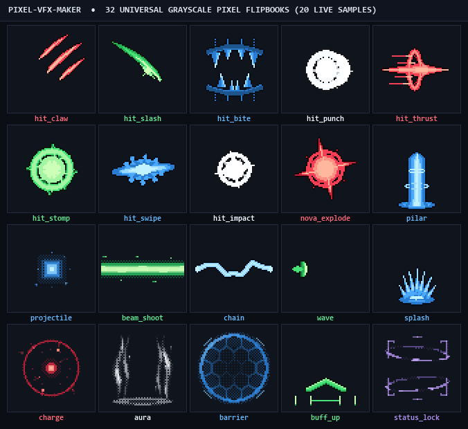
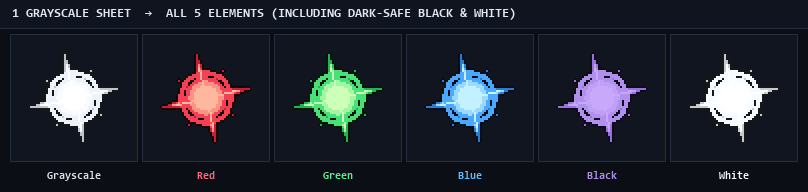
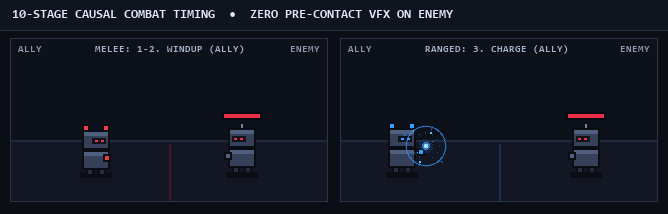

# Pixel VFX Maker (`pixel-vfx-maker`)

> **Procedural Pixel-Art VFX Flipbook Creation, 10-Stage Causal Combat Timing, Universal Grayscale Tinting, 3D Plane Preview Studio, & Roblox Studio Deployment Skill.**

An installable AI Agent Skill (`SKILL.md`) paired with a **zero-dependency offline WebGL 3D Plane Studio** featuring **32 universal grayscale pixel-art VFX flipbooks** calibrated for **Red, Green, Blue, Black, and White** tinting (plus **Dual-Color Combine fusions**) and 1:1 deployment to **Roblox Studio** (`ParticleEmitter` + `SurfaceGui` `Pixelated` 3D planes).

---

## Live Animated Showcases

### 1. 32 Universal Grayscale Pixel VFX Catalog (20 Live Samples)


### 2. One Grayscale Sheet → All 5 Elements (Including Dark-Safe Black & White)


### 3. 10-Stage Causal Combat Timing (Zero Pre-Contact VFX on Enemy)


---

## Core Design Principles (Encoded in `SKILL.md`)

### 1. Mandatory 10-Stage Animation & VFX Lifecycle
Every combat ability enforces strict **causal order** and **spatial ownership** so impact effects never spawn early or on the wrong unit:

| # | Stage | Spatial Owner | Enemy Impact VFX Allowed? |
| :--- | :--- | :--- | :--- |
| 1 | **Anticipation** | Ally / Caster | **No (`0 px`)** |
| 2 | **Wind-up** | Ally / Caster | **No (`0 px`)** |
| 3 | **Charging** | Ally / Muzzle / Weapon | **No (`0 px`)** |
| 4 | **Casting** | Ally / Caster | **No (`0 px`)** |
| 5 | **Release** | Ally Launch Point | **No (`0 px`)** |
| 6 | **Travel** | Mid-Air / Arena Path | **No (`0 px`)** |
| 7 | **Impact** | Enemy Hitbox | **Yes — Instant Contact (`F0`/`F1`)** |
| 8 | **Follow-through** | Ally + Impact Zone | Active aftershock & shards |
| 9 | **Recovery** | Ally & Enemy | Stance reset |
| 10 | **Dissipation** | Impact / World | Clean fade to **`0 px`** (OneShot) |

### 2. Five 3D Plane Geometries & Anti-Distortion Rules (WebGL ↔ Roblox 1:1)
- **Camera Billboard (`FacingCamera`):** Instant-contact hits (`hit_*`), `charge`, `nova_explode`, `smoke_puff`, `rubble`, and **1:1 symmetric `projectile`** (`Energy Square` — zero baked horizontal trails so 360° camera orbits never point the tail backward!).
- **Horizontal Ground XZ (`FloorPart`):** `floor_effect`, `pulse`, `hit_stomp`, `wave`, `ground_fissure`.
- **Crossed Vertical X-Plane (`CrossedMesh`):** `pilar`, `aura`, `barrier`, `rise_particles`, `rain`, `splash`, `buff_up`, `debuff_down`, `status_lock`, `status_cleanse`.
- **1:1 Tiled Stretched Ribbon (`Beam` / `SurfaceGui`):** `beam_shoot` & `chain` — tiles `N = round(length / thickness)` square cells cropping the `2px` (`8px` @ 4×) safe UV border so laser pixels stay crisp **1:1 squares** across any distance (never stretched into wide horizontal bars!).
- **3D Orbit Ring:** `orbit` (multi-billboard 3D ring revolving around Y axis).

### 3. Anti-Mewah Modular Tier Scaling (5 Tiers by Code)
Base flipbooks stay restrained and readable; visual richness scales dynamically by code (no duplicate sprite sheets per tier):
- **Common / Uncommon (`0.80×`):** 1 layer, compact, fast clean fade, zero camera shake.
- **Combine `C+C` / `U+C` (`0.95×`):** 1–2 layers (base + subtle charge/impact accent).
- **Rare (`1.08×`):** 2 layers (base + ground pulse / smoke / splash accent).
- **Combine `U+U` / `C+R` (`1.18×`):** 2–3 layers + **Dual-Color Fusion Tint** (Primary Element core + Secondary Element ring/aura).
- **Epic (`1.32×`):** 3–4 layers across the full 10-stage lifecycle.

---

## Included 32 Universal Grayscale VFX (`studio/`)

- **Support & Sustain (7 — `4×4`, 16f):** `charge`, `aura` *(transparent center window)*, `floor_effect`, `barrier` *(abstract hex field, non-shield)*, `rise_particles` *(neutral rising motes)*, `buff_up`, `debuff_down`
- **Travel & Delivery (7 — `4×4`, 16f):** `projectile` *(1:1 glowing `Energy Square`)*, `beam_shoot` *(uniform straight tileable laser)*, `chain`, `orbit`, `rain`, `wave`, `ground_fissure`
- **Contact Hits (8 — `4×4`, 16f, Instant-Contact `F0`/`F1`):** `hit_impact`, `hit_punch`, `hit_slash`, `hit_claw`, `hit_bite`, `hit_swipe`, `hit_stomp`, `hit_thrust`
- **Area & World (6 — `4×4`, 16f):** `pulse`, `nova_explode`, `pilar`, `rubble`, `splash`, `smoke_puff`
- **Abstract Status VFX (4 — `4×2`, 8f lightweight):** `status_lock`, `status_cancel`, `status_dot_tick`, `status_cleanse`

---

## Quick Start

### Install as an Agent Skill
Copy `SKILL.md` into your global or workspace skills folder:
- **Global (Antigravity / Gemini):** `~/.gemini/config/skills/pixel-vfx-maker/SKILL.md`
- **Project-Specific:** `.agents/skills/pixel-vfx-maker/SKILL.md`

### Run the Offline 3D Plane Studio (Zero Dependencies)
Double-click [`studio/index.html`](studio/index.html) directly in any modern browser — no npm install, no build step, no local server required:
- **Drag** to orbit 360° around the 3D planes • **Scroll** to zoom • **Double-click** to reset camera
- Toggle **Plane Wireframes** to inspect exact 3D quad orientations
- Switch **5 Elements + Dual-Color Combine** & **5 Rarity Tiers** live on GPU
- Export **`1024×1024` (4×4) / `1024×512` (4×2)** nearest-neighbor transparent PNGs (`0` edge bleed) + copy Roblox Luau snippets

---

## Repository Layout

```text
pixel-vfx-maker/
├── SKILL.md                            # Installable Agent Skill definition
├── README.md                           # Documentation & animated showcases
├── assets/
│   ├── showcase_catalog_grid.gif       # 20 live animated pixel VFX grid
│   ├── showcase_elements_tint.gif      # 1 grayscale -> 5 elements tint demo
│   └── showcase_10stage_causal.gif     # 10-stage causal Melee vs Ranged demo
└── studio/                             # Offline WebGL 3D Plane Studio (file:/// ready)
    ├── index.html
    ├── styles.css
    ├── core/
    │   ├── pixel_engine.js             # Integer 64x64 grayscale rasterizer (2px safe margin)
    │   ├── webgl_3d_engine.js          # Zero-dependency WebGL 3D Plane renderer
    │   └── app.js                      # 10-Stage Causal Timeline + Tier Compositor + Exporter
    └── vfx/
        ├── pack_support.js             # 7 Support & Sustain VFX
        ├── pack_delivery.js            # 7 Travel & Delivery VFX
        ├── pack_hits.js                # 8 Instant-Contact Hit VFX
        ├── pack_world.js               # 6 Area & World VFX
        └── pack_status.js              # 4 Lightweight 8-Frame Status VFX
```
